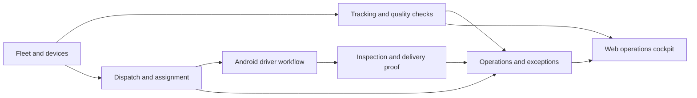
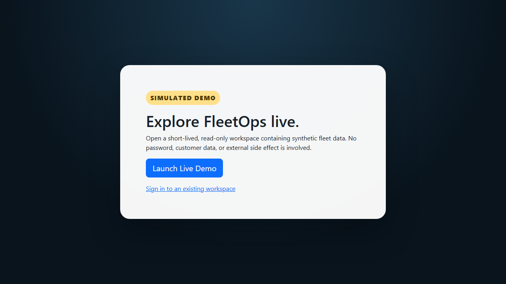
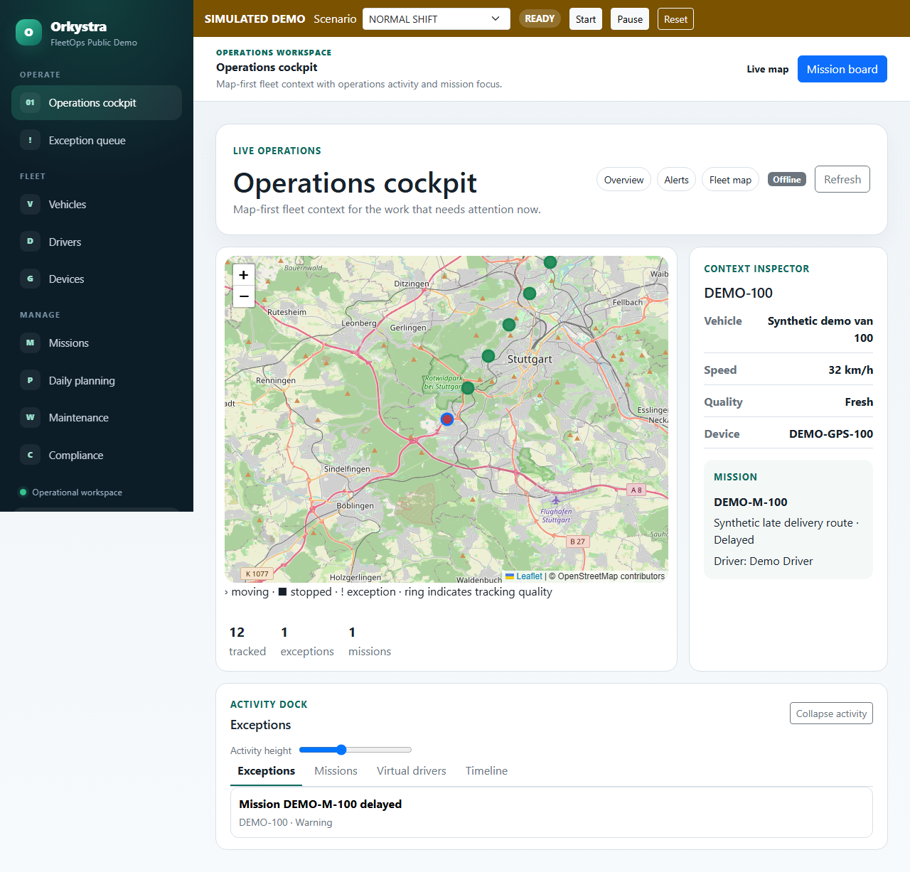
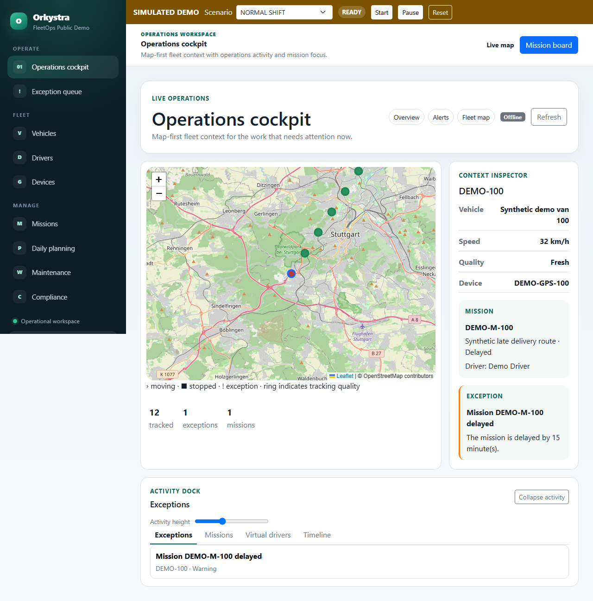
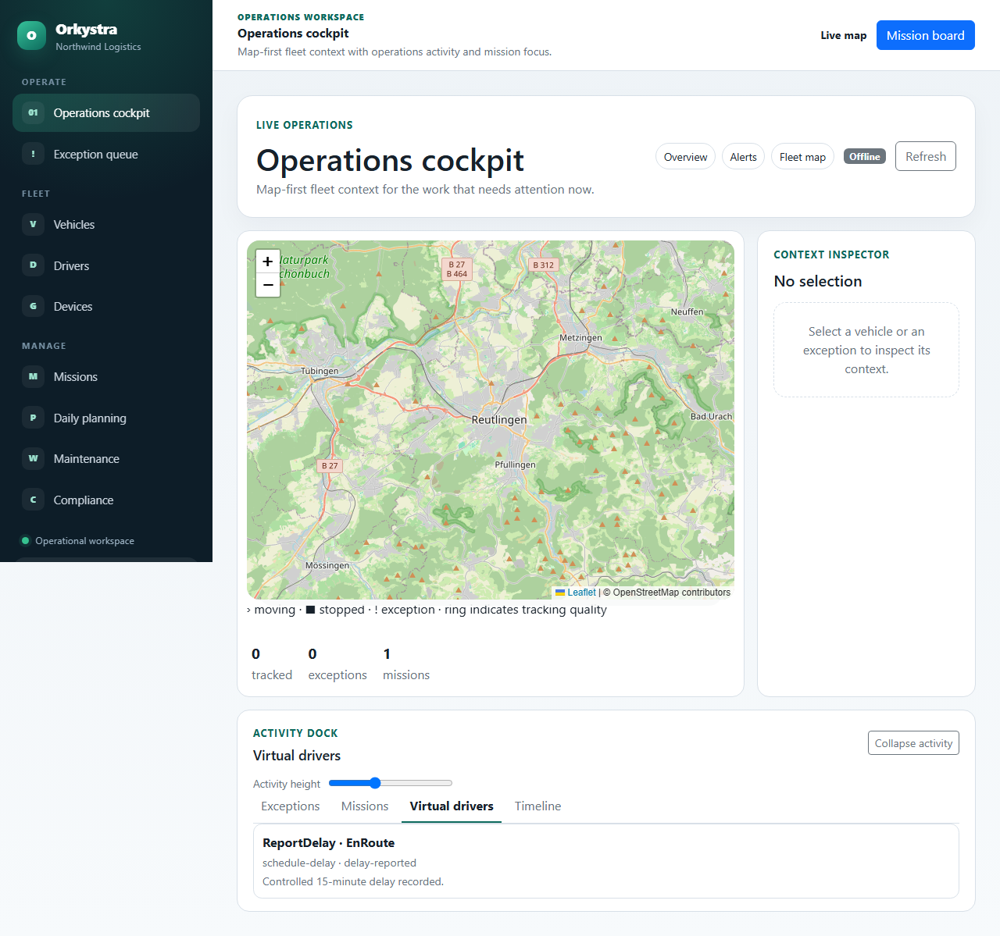
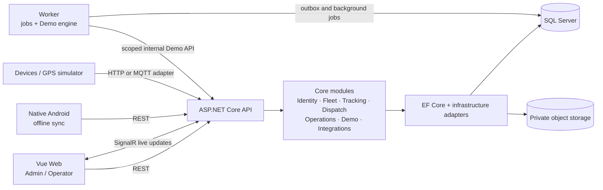

# FleetOps

**Fleet operations MVP for small delivery and field-service teams.** FleetOps connects dispatch, live vehicle tracking, driver execution, delivery evidence, and exception handling in one tenant-aware system. It is a portfolio implementation and a reproducible synthetic demonstration, not a live commercial service.

> **Project status (November 2026):** Sprints 00–34 are complete. Four consolidation sprints remain (35–38): Control Tower UX, contract and Android consolidation, hosted virtual drivers, and public self-hosting. [Roadmap](ROADMAP.md) · [Current sprint](.agent/CURRENT_SPRINT.md)

## The operational path

An operator assigns a mission to a vehicle and driver. The driver can work offline, record an inspection and delivery proof, and sync when connected. GPS events update the fleet view; delays and defects become exceptions for the operator. The Demo exercises this chain with synthetic tenants, routes, vehicles, and workflows.



| Surface | Delivered capability |
|---|---|
| Web · Admin / Operator | Fleet registry, map-first cockpit, dispatch, exception queue, maintenance, compliance, integrations, and audited administration. |
| Android · Driver | Assigned missions, offline-first execution and sync, inspections, photo/signature proof, and mission status. |
| API / Worker | Tenant-scoped workflows, telemetry ingestion/history, SignalR updates, private media, audit/outbox jobs, and deterministic Demo scenarios. |

The implementation progressed from identity and fleet data, through dispatch and driver workflows, to live tracking and a safe Demo runtime. The current phase consolidates those capabilities into a clearer, publicly demonstrable Control Tower. [Product scope](docs/00-product/MVP_SCOPE.md) · [Architecture decision](docs/01-architecture/ADR/0001-modular-monolith.md)

## See the Demo

The public Demo launches a short-lived, read-only Operator session for a labelled synthetic tenant. Its Worker animates a repeatable fleet through the normal tracking API. Select a vehicle to inspect its mission and tracking quality, then follow an exception in the activity dock. The local development simulation also demonstrates virtual-driver actions through the real mission, inspection, and proof contracts.

| Launch a synthetic session | Inspect the moving fleet |
|---|---|
| <a href="docs/assets/screenshots/demo-launch.png"></a> | <a href="docs/assets/screenshots/demo-cockpit-fleet.png"></a> |
| **Investigate a delayed mission** | **Review a virtual-driver action** |
| <a href="docs/assets/screenshots/demo-vehicle-exception.png"></a> | <a href="docs/assets/screenshots/demo-agent-activity.png"></a> |

The [Android mission screen](docs/assets/screenshots/android-driver-mission-detail.png) shows stops and the driver's mission timeline. These captures are **simulated development evidence**, not customer, pilot, or production evidence. The virtual-driver capture uses a development workspace; hosted Demo identity provisioning is planned for Sprint 37. [Full walkthrough and scenario catalogue](docs/00-product/DEMO_WALKTHROUGH.md)

### Run locally

**Requirements:** Docker with Compose, PowerShell 7 (`pwsh`), and free ports for the Web/API and backing services. Copy `.env.example` to `.env` and replace its placeholder secrets, including the Base64-encoded 32-byte MinIO KMS key. Keep `.env` local.

```powershell
Copy-Item .env.example .env
# Edit .env: replace the example secrets and KMS key.
pwsh -File scripts/demo-up.ps1
# Open http://localhost:8081/demo (or FLEETOPS_WEB_PORT from .env).
pwsh -File scripts/demo-down.ps1
```

For an automated readiness, session-sandbox, reset, and animated-fleet check, run `pwsh -File scripts/demo-smoke.ps1 -SkipBuild` **after stopping the interactive stack**: the smoke script uses its own Compose project and the same host ports. It stops its containers when finished. [Deployment profiles](docs/01-architecture/DEPLOYMENT_TOPOLOGY.md) · [Demo security](docs/01-architecture/DEMO_MODE_SECURITY.md)

## Architecture and module boundaries

FleetOps is one ASP.NET Core modular monolith (`Api`, `Core`, `Infrastructure`) plus a Worker. Vue 3/Pinia/Leaflet serves administrators and operators; the native Android app serves drivers. SQL Server is the transaction source, EF Core migrations manage its schema, and private S3-compatible storage holds media. REST carries commands and history; SignalR carries current positions, states, and alerts. MQTT is limited to device/simulator integration.



Identity supplies the authenticated organization; tenant-aware records carry `OrganizationId`, and sensitive actions are authorized on the server. Tracking links device events to vehicles and exposes current positions/history; Dispatch links vehicles, drivers, missions, and stops; Operations consumes those read models for exceptions and the cockpit. The Worker runs deferred jobs and synthetic scenarios through application contracts, never by directly editing business tables. [Backend architecture](docs/01-architecture/ARCHITECTURE.md) · [Domain model](docs/01-architecture/DOMAIN_MODEL.md) · [Demo engine](docs/01-architecture/HOSTED_DEMO_ENGINE.md)

## What is proven, and what remains

- **Validated locally:** the Sprint 34 full gate passed across backend, SQL Server/MinIO integration, multi-tenant simulation, Web unit/E2E, API health, and Android lint/unit/APK build. Its 20-vehicle restart exercise recorded no tracking-quality rejection. [Quality report](.agent/QUALITY_REPORT.md) · [Simulation measurements](docs/02-engineering/SPRINT34_SIMULATION_EVIDENCE.md)
- **Demo boundary:** synthetic data, expiring least-privilege sessions, rate limits, server-side tenant checks, sandboxed side effects, and a visible `SIMULATED DEMO` label. There is no real customer data in the Demo profile. [Security design](docs/01-architecture/DEMO_MODE_SECURITY.md)
- **Remaining work:** the cockpit's complete timeline/selection UX (35), contract and Android consolidation (36), hosted virtual-driver credentials (37), and a public self-hosted release with final proof (38). The current Demo runs locally; it is not a public deployment. [Roadmap](ROADMAP.md)
- **Explicit limits:** Demo load evidence covers up to 20 vehicles, not production scale. Public hosting, a map-tile provider/policy, commercial name/positioning, and legal readiness still require decisions. No proprietary route optimization, iOS app, WMS, billing, or general-purpose AI is part of this MVP. [Release checklist](docs/02-engineering/RELEASE_CHECKLIST.md)

## Work on the repository

| Area | Location | Main entry point |
|---|---|---|
| Backend and Worker | `apps/backend/` | `FleetOps.slnx` |
| Web | `apps/web/` | `package.json` |
| Native Android | `apps/android-driver/` | `gradlew` / `gradlew.bat` |
| Infrastructure and scripts | `docker-compose*.yml`, `scripts/` | `scripts/demo-up.ps1` |
| Contracts and evidence | `sprints/`, `docs/`, `.agent/` | `ROADMAP.md` |

After configuring `.env`, run `pwsh -File scripts/quality-gate.ps1` for the required format, static analysis, builds, tests, integration checks, simulation, Web journeys, and Android checks. This needs .NET 10, Node.js 24, a JDK/Android SDK, Docker, and PowerShell; it can take several minutes. [Validation policy](VALIDATION.md) · [CI workflow](.github/workflows/release-validation.yml)

Sprint work follows the [atomic sprint runner](docs/02-engineering/SPRINT_AUTOPILOT.md): `Start Next Sprint` selects one eligible sprint, logs visible progress under `.runtime/`, validates it, and stops. `Start Next Sprints N` is bounded to `1..10` and still requires a separate context for each sprint.
